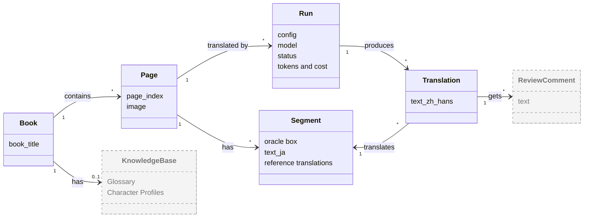
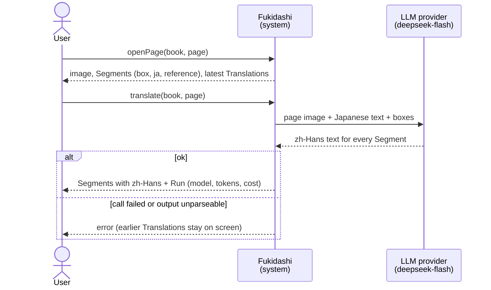
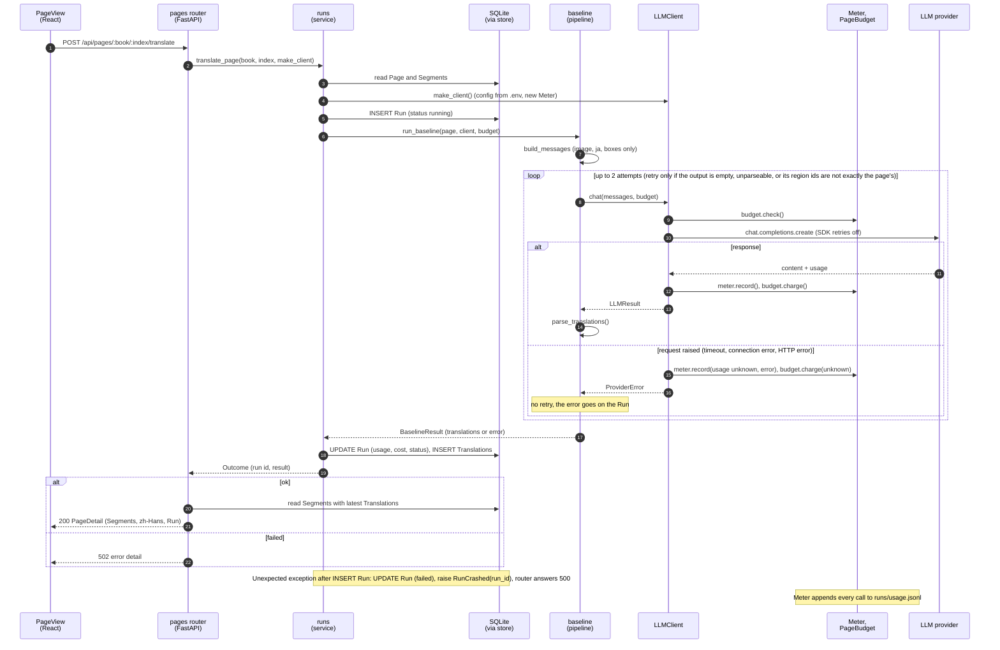
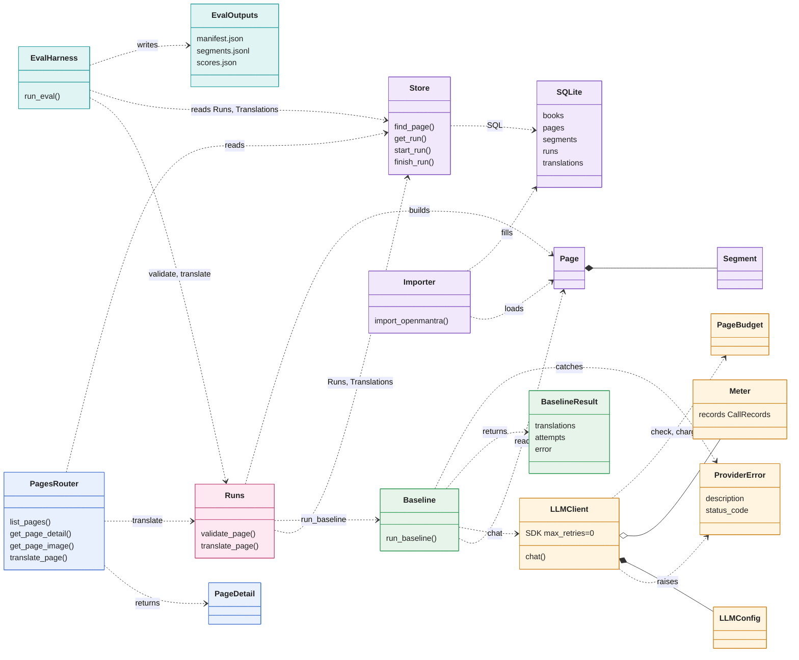
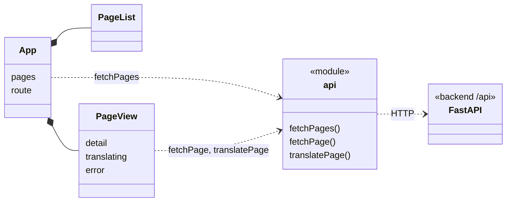

# Design Diagrams

> 2026-10-27 · Matches the code after M2's first four tasks: the eval harness v0, the Run status and cost fixes, and provider error handling. Diagrams are Mermaid and render on GitHub.
> **Solid = implemented; dashed = planned** (milestones in [OUTLINE.md](../OUTLINE.md) §7). Terms follow OUTLINE §0.

Fukidashi translates Japanese manga into Simplified Chinese (zh-Hans). Each page has several Segments (one line of dialogue in one oracle box); the model looks at the whole page image and translates them together, and the user checks the translations against the boxes in the browser.

**How to read this:** diagrams 1 and 2 answer "what is this system and how is it used" in about a minute; diagrams 3 and 4 answer "how is it built", for when you change code.

---

## 1. Domain Model

Only the concepts of the problem domain and their relationships; no code.

- A page has many **Segments**. Every click on Translate creates a **Run**, and the Run gives each Segment one **Translation**. The page shows its latest successful Run.
- **Reference translations** (OpenMantra's zh-Hant and en translations) belong to the Segment and are used only for comparison and evaluation, never in a prompt.
- `Run.config` is only `baseline` for now (one call per page, no tools, no KB); `full` and `full_no_kb` arrive in M2–M3.
- The dashed **KnowledgeBase** (M3) and **ReviewComment** (M3) do not exist yet.

---

## 2. System Sequence Diagram

The system as a black box: what the user asks for, what comes back, and which external system is involved.

---

## 3. Object Interaction Diagram

Inside the system: which objects one `translate` request passes through, and in what order (`translate_page` in `api/pages.py` and `translate_page` in `runs.py`).

---

## 4. Object Model

The objects in the code and how they depend on each other (the actual structure after M2's first four tasks).

### 4.1 Backend

Colors mark layers: blue = API, teal = eval, pink = service, green = pipeline, orange = LLM, purple = data.

- `PagesRouter` only parses parameters, maps errors to status codes and shapes responses; it has no SQL. "Translate a page and record a Run" lives in `Runs.translate_page`, and the SQL lives in `Store`.
- `Runs.translate_page` does not depend on HTTP, so the eval harness calls it directly (OUTLINE §1.3, Same code path). An invalid page raises `PageNotFound` or another `TranslateError` before any Run exists, which the router maps to 404 / 422. A failed model call or unparseable output is not an exception but a `failed` Run (502). An unexpected exception after the Run row exists marks that Run failed and is raised as `RunCrashed` with its `run_id` (500).
- `EvalHarness` (`evaluation/harness.py`; CLI `eval/run.py`) calls `validate_page` for every page before the first model call, then `translate_page` page by page, and scores the stored Translations against references converted with OpenCC `t2s`. It writes `EvalOutputs` to `runs/eval/<id>/`; `scores.json` reports scored and failed Runs' cost separately, and any unknown cost makes a total `null`.
- `PagesRouter` gets the SQLite connection, the dataset path and the `LLMClient` factory through FastAPI's `Depends` (`get_db`, `get_dataset_root`, `get_client_factory`). Tests swap them for a temporary DB and a fake `LLMClient`, so tests never make real requests.
- `Runs` receives an `LLMClient` factory, not a client: every Run builds its own `LLMClient` and `Meter`, so each Run's usage is its own.
- `llm/` (`LLMClient` and `describe_api_error`) is the only code that imports `openai`. `LLMClient` turns the SDK's automatic retries off, so every request sent is one call in the `Meter`. A request that raises is recorded with unknown usage and an `error`, then leaves `llm/` as `ProviderError`. `Baseline` puts that error on the Run without retrying (OUTLINE §3.6: a request that may have been billed is not resent automatically); it retries only empty or unparseable output.
- `Baseline` touches neither HTTP nor SQLite.

### 4.2 Frontend

### 4.3 Concept → table → object

| Domain concept | SQLite table | Backend object | API / frontend type |
|---|---|---|---|
| Book | `books` | `book_title` (string) | `PageSummary.book_title` |
| Page | `pages` | `Page` | `PageSummary`, `PageDetail` |
| Segment | `segments` | `Segment` | `SegmentOut` / `Segment` |
| Run | `runs` | No class of its own: `Runs.translate_page` writes the row through `Store.start_run` / `finish_run`, using `Meter.summary()` and `BaselineResult` | `RunOut` / `Run` |
| Translation | `translations` | `BaselineResult.translations` | `Segment.text_zh_hans` |
| Manifest | none (`runs/eval/<id>/manifest.json`) | written by `run_eval` | none |

### 4.4 Where later milestones plug in

- **M2:** an Orchestrator and the Translator Agent (a tool loop; directories `orchestrator/` and `agents/` in OUTLINE §6) join `Baseline`. `LLMClient`, `Meter` and `PageBudget` stay as they are, and every agent call goes through them; `Runs.translate_page` picks Baseline or the Orchestrator by `config`, and `EvalHarness` accepts each config as it arrives (`CONFIGS` in `evaluation/harness.py`).
- **M3:** the `KB` (Glossary, Character Profiles, Proposal Queue) and the Reviewer / Curator Agents; `runs.config` gains `full` and `full_no_kb`.
- **M7:** the frontend adds a canvas and editing to `PageView`, plus SSE, which adds an event subscription to the `api` module.
