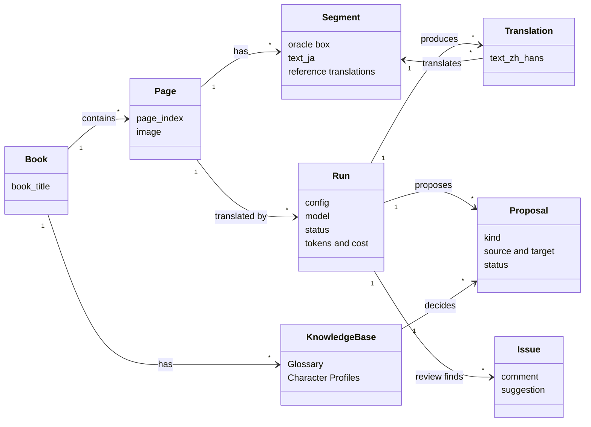
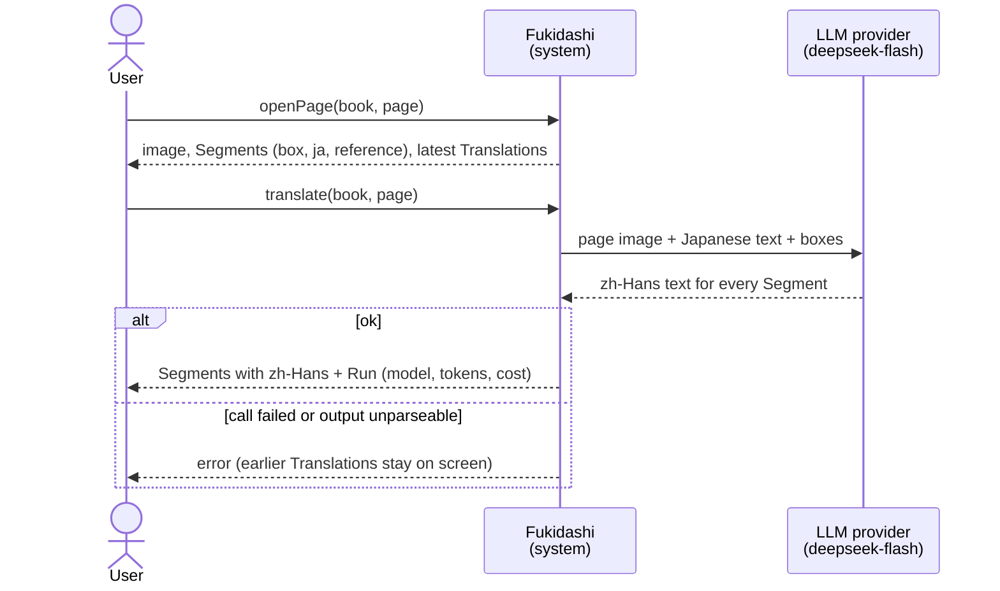
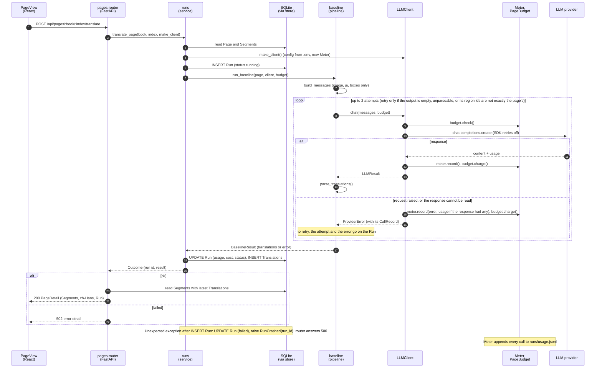
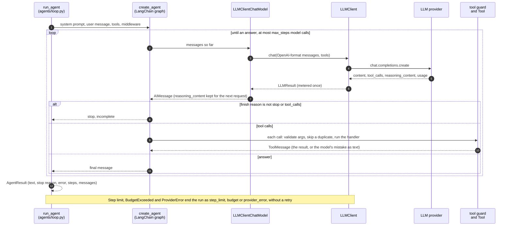
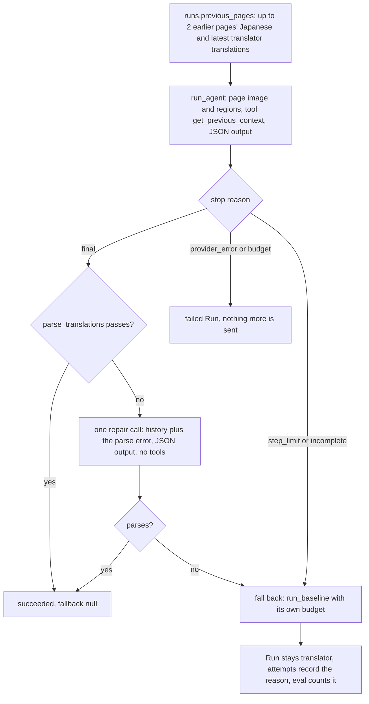
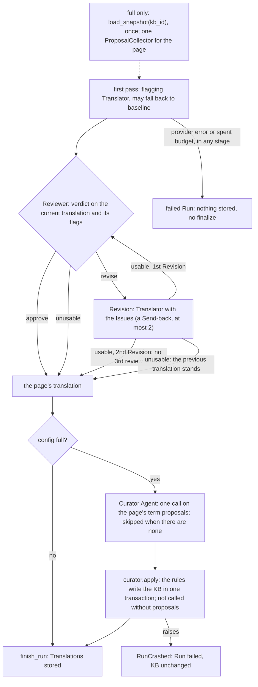
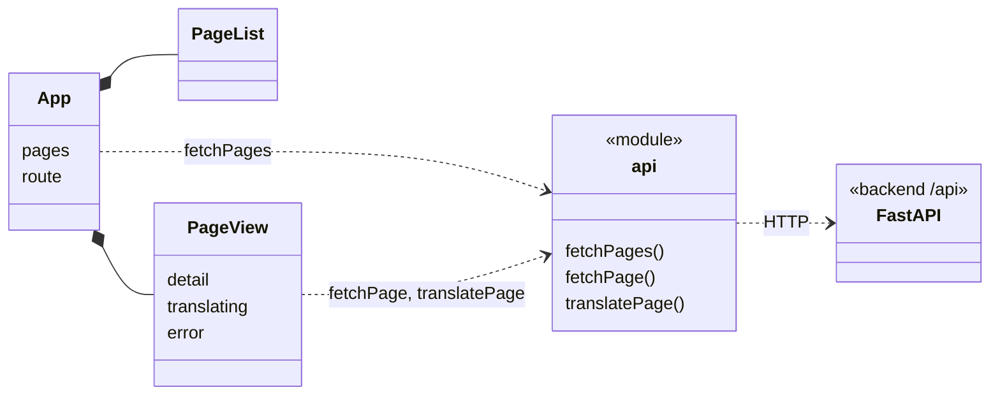

# Design Diagrams

> 2026-10-28 · Matches the code at the end of M3. M2 added the eval harness v0, the Run status and cost fixes, provider and malformed-response error handling, the tool-calling loop, the Translator Agent and tracing. M3 added the Reviewer, the Orchestrator, the Knowledge Base and the Curator. Diagrams are Mermaid and render on GitHub.
> **Solid = implemented; dashed = planned** (milestones in [OUTLINE.md](../OUTLINE.md) §7). Terms follow OUTLINE §0.

Fukidashi translates Japanese manga into Simplified Chinese (zh-Hans). Each page has several Segments (one line of dialogue in one oracle box); the model looks at the whole page image and translates them together, and the user checks the translations against the boxes in the browser.

**How to read this:** diagrams 1 and 2 answer "what is this system and how is it used" in about a minute; diagrams 3 and 4 answer "how is it built", for when you change code.

---

## 1. Domain Model

Only the concepts of the problem domain and their relationships; no code.



- A page has many **Segments**. Every click on Translate creates a **Run**, and the Run gives each Segment one **Translation**. The page shows its latest successful Run.
- **Reference translations** (OpenMantra's zh-Hant and en translations) belong to the Segment and are used only for comparison and evaluation, never in a prompt.
- `Run.config` is `baseline` (one call per page, no tools, no KB), `translator` (the Translator Agent alone, M2's smoke config), `full_no_kb` (Translator, Reviewer, Send-backs) or `full` (the same with a Knowledge Base).
- A book has one **KnowledgeBase** per use: each `full` eval run makes a new one, and the editor will keep one per book (M7). A `full` Run **proposes** entries; at finalize the Curator and the rules **decide** each Proposal, and only then can it become a Glossary entry or a Character Profile.
- A review's **Issues** (a comment and a suggestion for one region) are kept in the Run's record. The editor does not show them yet (M7).

---

## 2. System Sequence Diagram

The system as a black box: what the user asks for, what comes back, and which external system is involved.



---

## 3. Object Interaction Diagram

Inside the system: which objects one `translate` request passes through, and in what order (`translate_page` in `api/pages.py` and `translate_page` in `runs.py`).



**Tracing** (optional, `FUKIDASHI_TRACING=phoenix`). The whole `translate_page` call runs inside one root span, so one page is one trace in the local Phoenix. The OpenInference instrumentors add a span for every provider call and for the agent graph and its tools. A `translator` page as recorded in M2, simplified (16 spans in all, most of them LangGraph's node and middleware spans):

```
translate_page tojime_no_siora/3   (config, run_id, run_status, calls, stop_reason, fallback_reason)
├─ LangGraph                       the agent: model and tool nodes, middleware
│  ├─ LLMClientChatModel           LangChain's view of a model call
│  ├─ get_previous_context         tool span: arguments and result
│  └─ LLMClientChatModel
├─ ChatCompletion                  the openai SDK call: messages, tokens (images replaced by "[image omitted]")
└─ ChatCompletion
```

The `ChatCompletion` spans are children of the root, next to the LangChain spans rather than inside them, because the LangChain instrumentor does not make its spans current. A `baseline` page is the root and one `ChatCompletion` span per call.

**The agent loop.** `run_agent` (`agents/loop.py`) runs a model through tool calls. The Translator Agent calls it for config `translator`, and `scripts/m2_tool_smoke.py` calls it with a toy tool. One run:



**The Translator Agent** (`translate_page` with config `translator`) wraps that loop: the agent's answer is checked, repaired once, or replaced by `baseline`, and the Run records which (OUTLINE §3.4, §3.6).



**The Orchestrator and finalize** (`translate_page` with config `full_no_kb` or `full`). The Orchestrator is plain code around the two agents; `full` adds the KB snapshot, read once before the page, and finalize after it (OUTLINE §3.2, §3.3, §3.6).



A Curator without a usable answer does not stop the page: its terms stay undecided, and `curator.apply` still applies the rules to the rest.

---

## 4. Object Model

The objects in the code and how they depend on each other (the actual structure at the end of M3).

### 4.1 Backend

Colors mark layers: blue = API, teal = eval, pink = service (`runs.py` and the Orchestrator), green = pipeline, lime = agents, brown = Knowledge Base, orange = LLM, purple = data, grey = tracing.

```mermaid
classDiagram
    direction LR

    class PagesRouter:::api {
        list_pages()
        get_page_detail()
        get_page_image()
        translate_page()
    }
    class PageDetail:::api
    class EvalHarness:::eval {
        run_eval()
    }
    class Tracing:::tracing {
        setup()
        page_span()
    }
    class Backend:::tracing {
        phoenix()
    }
    class RedactingExporter:::tracing
    class EvalOutputs:::eval {
        manifest.json
        segments.jsonl
        scores.json
    }
    class TermAccuracy:::eval {
        score_terms()
    }
    class CometScript:::eval {
        eval/comet.py
    }
    class PooledReport:::eval {
        build_report()
    }
    class Runs:::service {
        validate_page()
        translate_page()
    }
    class Baseline:::pipeline {
        run_baseline()
    }
    class BaselineResult:::pipeline {
        translations
        attempts
        error
    }
    class Translator:::agent {
        run_translator()
        get_previous_context
    }
    class Orchestrator:::service {
        run_orchestrator()
        MAX_SEND_BACKS = 2
    }
    class OrchestratorResult:::service {
        translations
        send_backs
        final_stop
        proposals
    }
    class Reviewer:::agent {
        run_reviewer()
    }
    class Curator:::agent {
        run_curator()
    }
    class KBTools:::agent {
        lookup_term
        lookup_character
        kb_snippets_part()
    }
    class AgentLoop:::agent {
        run_agent()
    }
    class LLMClientChatModel:::agent
    class Tool:::agent {
        name
        args pydantic model
        handler
    }
    class AgentResult:::agent {
        text
        stop_reason
        steps
        messages
    }
    class LLMClient:::llm {
        chat(tools)
        SDK max_retries=0
    }
    class ProviderError:::llm {
        description
        status_code
        record
    }
    class LLMConfig:::llm
    class Meter:::llm {
        records CallRecords
    }
    class PageBudget:::llm
    class KBSnapshot:::kb {
        entries
        profiles
    }
    class ProposalCollector:::kb {
        propose()
    }
    class KBLoader:::kb {
        load_snapshot()
    }
    class CuratorRules:::kb {
        apply()
        RESULTS
    }
    class Page:::data
    class Segment:::data
    class Store:::data {
        find_page()
        get_run()
        start_run()
        finish_run()
        create_kb()
    }
    class SQLite:::data {
        books
        pages
        segments
        runs
        translations
        kbs
        glossary_entries
        character_profiles
        proposals
    }
    class Importer:::data {
        import_openmantra()
    }

    PagesRouter ..> PageDetail : returns
    PagesRouter ..> Runs : translate
    PagesRouter ..> Store : reads
    EvalHarness ..> Runs : validate, translate
    EvalHarness ..> Store : reads Runs, Translations; makes the KB (full)
    EvalHarness ..> EvalOutputs : writes
    TermAccuracy ..> EvalOutputs : reads segments.jsonl, writes terms.json
    CometScript ..> EvalOutputs : reads segments.jsonl, writes comet-*.json
    PooledReport ..> EvalOutputs : reads several, writes runs/report/
    Runs ..> Tracing : page_span
    Tracing ..> Backend : exporter
    Tracing ..> RedactingExporter : wraps the exporter
    Runs ..> Store : Runs, Translations
    Runs ..> Baseline : config baseline
    Runs ..> Translator : config translator
    Runs ..> Orchestrator : config full_no_kb, full
    Runs ..> KBLoader : full, before the page
    Runs ..> Curator : full, finalize
    Runs ..> CuratorRules : full, finalize
    Orchestrator ..> Translator : first pass, Revisions
    Orchestrator ..> Reviewer : reviews
    Orchestrator ..> ProposalCollector : one per page
    Orchestrator ..> OrchestratorResult : returns
    Translator ..> AgentLoop : run_agent
    Translator ..> Baseline : fallback
    Translator ..> KBTools : with a snapshot
    Translator ..> ProposalCollector : propose_entry
    Reviewer ..> AgentLoop : run_agent
    Reviewer ..> KBTools : lookups only
    Curator ..> AgentLoop : run_agent, no tools
    Curator ..> KBTools : snippets part
    KBTools ..> KBSnapshot : reads
    KBLoader ..> Store : reads
    KBLoader ..> KBSnapshot : builds
    CuratorRules ..> Store : KB writes, one transaction
    Runs ..> Page : builds
    Baseline ..> Page : reads
    Baseline ..> LLMClient : chat
    Baseline ..> BaselineResult : returns
    Baseline ..> ProviderError : catches
    LLMClient ..> ProviderError : raises
    LLMClient *-- LLMConfig
    LLMClient o-- Meter
    LLMClient ..> PageBudget : check, charge
    AgentLoop ..> LLMClientChatModel : model of create_agent
    AgentLoop ..> Tool : runs
    AgentLoop ..> AgentResult : returns
    LLMClientChatModel ..> LLMClient : chat
    Page *-- Segment
    Store ..> SQLite : SQL
    Importer ..> Page : loads
    Importer ..> SQLite : fills

    classDef api fill:#e8f0fe,stroke:#4a78d0,color:#222
    classDef eval fill:#e0f4f4,stroke:#2a9d9d,color:#222
    classDef tracing fill:#eeeeee,stroke:#777777,color:#222
    classDef service fill:#fde8f1,stroke:#c4527f,color:#222
    classDef pipeline fill:#e6f4ea,stroke:#3a9d5d,color:#222
    classDef agent fill:#eef6d8,stroke:#7a9a2a,color:#222
    classDef kb fill:#f6ece2,stroke:#a8743f,color:#222
    classDef llm fill:#fff4e0,stroke:#d08a2a,color:#222
    classDef data fill:#f1e9fb,stroke:#8a5fc4,color:#222
```

- `PagesRouter` only parses parameters, maps errors to status codes and shapes responses; it has no SQL. "Translate a page and record a Run" lives in `Runs.translate_page`, and the SQL lives in `Store`.
- `Runs.translate_page` does not depend on HTTP, so the eval harness calls it directly (OUTLINE §1.3, Same code path). An invalid page raises `PageNotFound` or another `TranslateError` before any Run exists, which the router maps to 404 / 422. A failed model call or unparseable output is not an exception but a `failed` Run (502). An unexpected exception after the Run row exists marks that Run failed and is raised as `RunCrashed` with its `run_id` (500).
- `EvalHarness` (`evaluation/harness.py`; CLI `eval/run.py`) calls `validate_page` for every page before the first model call, then `translate_page` page by page, and scores the stored Translations against references converted with OpenCC `t2s`. It writes `EvalOutputs` to `runs/eval/<id>/` after every page, so an interrupted eval keeps the pages it finished (its manifest's `finished_at` stays null); `scores.json` reports scored and failed Runs' cost separately, and any unknown cost makes a total `null`. For `full` it also reports KB reach, read from each stored Run: the snippets the page was shown (`kb_snippets`, which `Runs` records from `KBSnapshot.snippet_items`), the lookups that found something or not, and the items that reached the page.
- Two scorers read a finished eval run's `EvalOutputs` and write a file of their own next to them, outside `EvalHarness` and the translation path, so they can score old runs again. `TermAccuracy` (`evaluation/terms.py`; CLI `eval/terms.py`) writes `terms.json` and reads neither the database nor the zh-Hant reference. `CometScript` (`eval/comet.py`) is a standalone script with its own environment that imports nothing from `fukidashi`, so PyTorch stays out of the project's lock and CI, and the script can run on another machine.
- `PooledReport` (`evaluation/report.py`; CLI `eval/report.py`) reads the `EvalOutputs` of several scored eval runs, one per config and book, and writes one report to `runs/report/<time>-report/`. It reads files only, compares the configs on the pages every config scored, recomputes chrF and BLEU over the pooled segments, and refuses files that do not belong together.
- `Tracing` (`tracing/`) is off unless `FUKIDASHI_TRACING` names a backend. `setup()`, called once by an entry point, installs the OpenInference instrumentors for the `openai` SDK and LangChain and a batch span processor whose exporter comes from `Backend` (Phoenix, which must be on this machine and is reached without any proxy), wrapped in `RedactingExporter` so no page image or API key reaches a span. `Runs` opens `page_span` around each page and returns its trace ID in `Outcome`, or on the exception when the page fails; `EvalHarness` writes it per page, failed pages included. Only `tracing/` imports OpenTelemetry or OpenInference, and tracing never fails a Run.
- `PagesRouter` gets the SQLite connection, the dataset path and the `LLMClient` factory through FastAPI's `Depends` (`get_db`, `get_dataset_root`, `get_client_factory`). Tests swap them for a temporary DB and a fake `LLMClient`, so tests never make real requests.
- `Runs` receives an `LLMClient` factory, not a client: every Run builds its own `LLMClient` and `Meter`, so each Run's usage is its own.
- `llm/` (`LLMClient` and `describe_api_error`) is the only code that imports `openai`. `LLMClient` turns the SDK's automatic retries off, so every request sent is one call in the `Meter`. A request that raises, or a response `LLMClient` cannot read (an HTML page, a body that is not JSON, no readable first choice), is recorded once with an `error`, with unknown usage unless the response carried some, then leaves `llm/` as `ProviderError` carrying that `CallRecord`. `Baseline` adds it to `attempts` and puts the error on the Run without retrying (OUTLINE §3.6: a request that may have been billed is not resent automatically), so a finished Run has one attempt per call; it retries only empty or unparseable output.
- `Baseline` touches neither HTTP nor SQLite.
- `AgentLoop` (`agents/loop.py`) is LangChain's `create_agent` with `LLMClientChatModel` as its model, so every agent call goes through `LLMClient` and is metered once; nothing in the loop retries. Its guardrails are the Step limit (`ModelCallLimitMiddleware`), a check that a reply ending for any reason other than `stop` or `tool_calls` is never an answer, and a tool guard that validates arguments against the `Tool`'s pydantic model, passes the model's mistakes back as the tool's result and does not run a duplicate call again. LangChain stays inside `agents/`: callers get an `AgentResult` of plain values with one step per model call. The Translator Agent is its one caller in the code (`scripts/m2_tool_smoke.py` is the other).
- `Translator` (`agents/translator.py`) is the `translator` config: it gives `AgentLoop` the page (the same user message as `Baseline`) and `get_previous_context`, whose data `Runs` reads from `Store` before the run, so the tool touches no database in LangGraph's worker threads. It checks the answer with `parse_translations`, repairs it once, and otherwise falls back to `Baseline` with a budget of its own; after a provider error or a spent budget it sends nothing more. The Run's `attempts_json` holds the agent's steps, the repair and the fallback, and `EvalHarness` reports the pages that fell back.
- `Orchestrator` (`orchestrator/flow.py`) runs `full_no_kb` and `full` as plain code: the flagging `Translator`, then `Reviewer` in a fresh conversation, then at most 2 Send-backs. It imports neither LangChain nor the database and returns an `OrchestratorResult` of plain values. With a `KBSnapshot` it makes the page's one `ProposalCollector`, gives the agents their KB tools through `KBTools`, and returns the page's proposals.
- **Least privilege for the KB.** `Translator` and `Reviewer` get a `KBSnapshot` (immutable, no connection) and, for the Translator, a `ProposalCollector`. `KBLoader` and `CuratorRules` are the only KB modules that use `Store`, and a test checks that loading the agents or the Orchestrator never loads the database module. `CuratorRules.apply` is the only caller of the store's KB write functions, which another test checks.
- **Finalize** (`full` only) is in `Runs`, after a successful page: `Curator` (one call on the Run's client, no tools; it judges the page's term proposals), then `CuratorRules.apply`, then `Store.finish_run`. `EvalHarness` makes one KB per `full` eval run and passes it to every page in order.

### 4.2 Frontend



### 4.3 Concept → table → object

| Domain concept | SQLite table | Backend object | API / frontend type |
|---|---|---|---|
| Book | `books` | `book_title` (string) | `PageSummary.book_title` |
| Page | `pages` | `Page` | `PageSummary`, `PageDetail` |
| Segment | `segments` | `Segment` | `SegmentOut` / `Segment` |
| Run | `runs` | No class of its own: `Runs.translate_page` writes the row through `Store.start_run` / `finish_run`, using `Meter.summary()` and `BaselineResult` | `RunOut` / `Run` |
| Translation | `translations` | `BaselineResult.translations` or `TranslatorResult.translations` | `Segment.text_zh_hans` |
| Manifest | none (`runs/eval/<id>/manifest.json`) | written by `run_eval` | none |
| Knowledge Base | `kbs` | `kb_id`; `KBSnapshot` (`load_snapshot`) to read it; one per `full` eval run | none yet |
| Term entry / Character Profile | `glossary_entries` / `character_profiles` | `GlossaryEntry` / `CharacterProfile` (`kb/entities.py`) | none yet |
| Proposal | `proposals` | `Proposal`, from `ProposalCollector`; written only by `curator.apply` | none yet |
| Flag, Verdict / Issue | none (inside a `full_no_kb` or `full` Run's `attempts_json`) | `TranslatorResult.flags`, `ReviewResult` | none yet |
| Curator decision, proposal outcome | `proposals.status` and reason; also a `full` Run's `attempts_json` (`finalize`) | `CuratorResult.decisions`; `curator.Outcome` (one of 8 results) | none yet |

### 4.4 Where later milestones plug in

- **M2 (done):** `Translator` built on `AgentLoop` runs beside `Baseline`, and `Tracing` wraps every `translate_page`. `LLMClient`, `Meter` and `PageBudget` stayed as they were, and every agent call goes through them. `Runs.translate_page` picks the pipeline by `config`, and `EvalHarness` accepts each config in `runs.CONFIGS`. An Orchestrator (`orchestrator/` in OUTLINE §6) comes with the Reviewer in M3.
- **M3 (done):** `Orchestrator`, `Reviewer` and `Curator` sit between `Runs` and `AgentLoop`, and the KB modules sit beside `Store`. `Runs.translate_page` gained the configs `full_no_kb` and `full`; for `full` it also loads the snapshot and runs finalize. Nothing in `LLMClient`, `AgentLoop` or the API changed shape: the editor still runs `baseline`.
- **M4 (done):** term accuracy went into `evaluation/` (#42); COMET became a standalone script in `eval/` (#41) instead, so its dependencies stay out of the project. Both read a finished eval run's outputs (`segments.jsonl`). `EvalHarness` reports how often the KB reaches a page (#40), and `PooledReport` pools the scored eval runs of both dev books (#44). Nothing in the translation path changed shape.
- **M5:** the judge model (GPT-4o mini) is a second `LLMClient`, with a configuration, a `Meter` and a ledger of its own; GEMBA-MQM and term consistency go into `evaluation/` and score a finished eval run's outputs, like term accuracy; prompt tuning changes the agents' prompts and re-baselines the pinned request digests.
- **M7:** the frontend adds a canvas and editing to `PageView`, plus SSE, which adds an event subscription to the `api` module.
