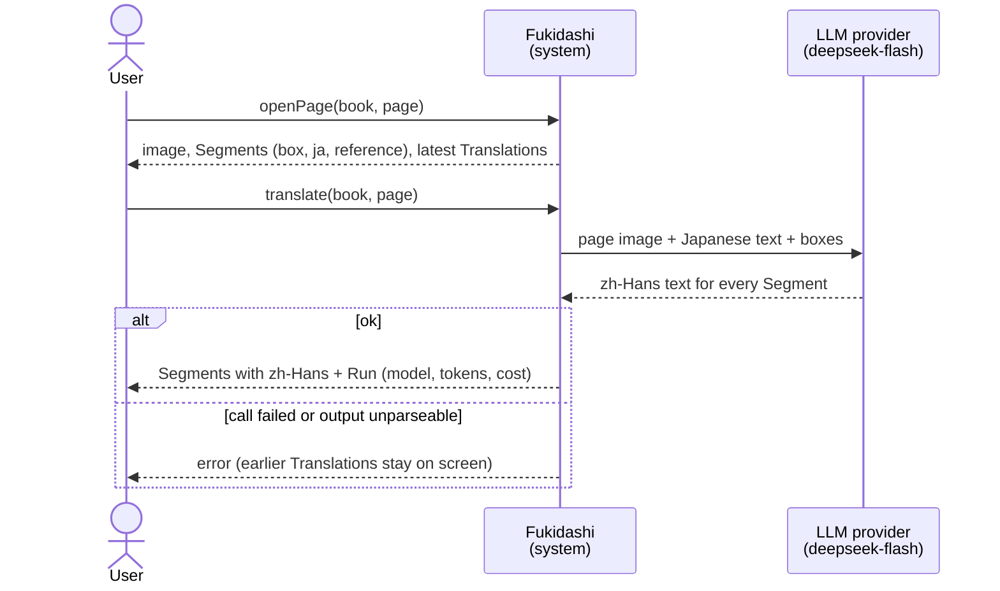
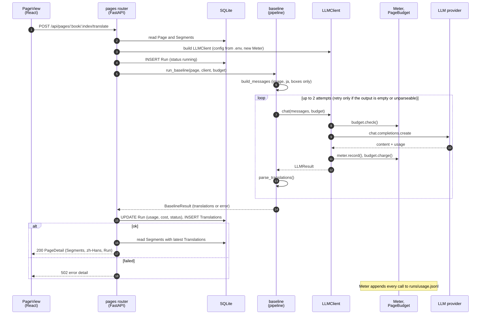
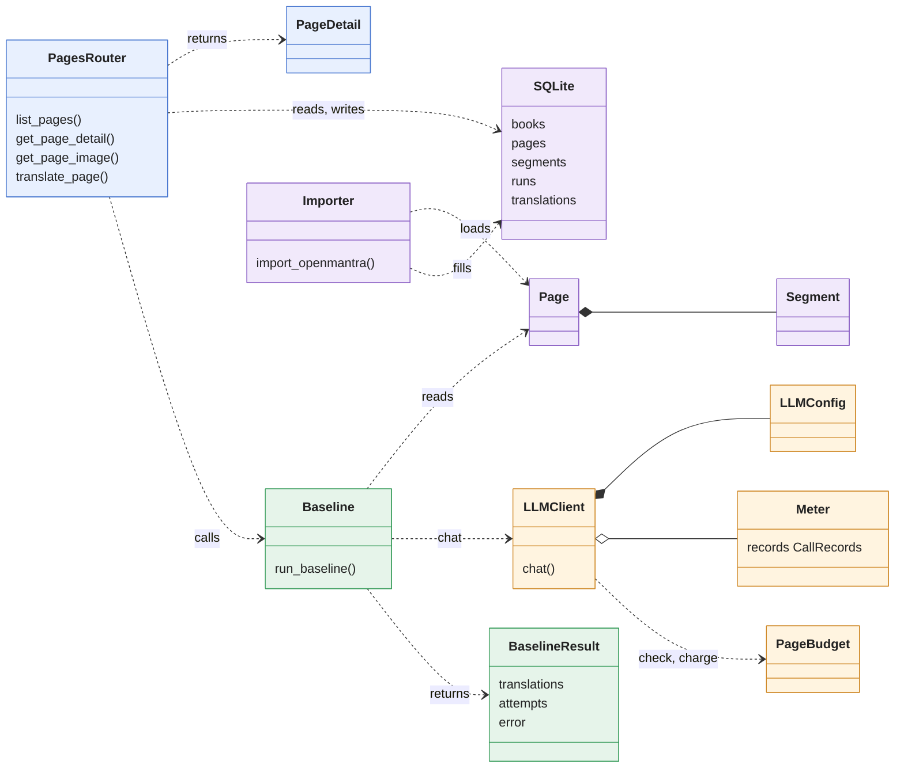
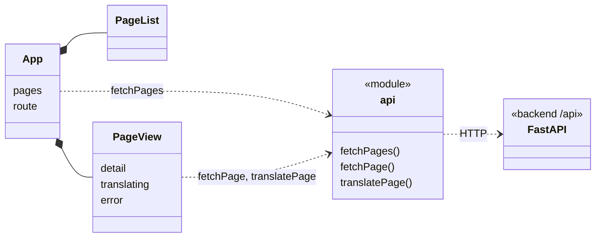

# Design Diagrams

> 2026-10-24 · 对应 M1 完成时的代码（`main` 上的 `4fa61fd`）。图用 Mermaid 写，GitHub 上直接渲染。
> **实线 = 已实现；虚线 = 计划中**（里程碑见 [OUTLINE.md](../OUTLINE.md) 第 7 节）。术语沿用 OUTLINE 第 0 节。

Fukidashi 把日文漫画翻成简体中文（zh-Hans）：每一页有若干个 Segment（一个 oracle box 里的一句台词），模型看着整页图片把它们一起翻译，用户在浏览器里对照图上的 box 检查译文。

**怎么读：** 图 1、2 回答「这个系统是什么、用户怎么用它」，一分钟能看完；图 3、4 回答「里面是怎么实现的」，要改代码时再看。

---

## 1. Domain Model（领域模型）

只画问题领域里的概念和它们的关系，不涉及代码。

- 一页有多个 **Segment**；每次点 Translate 产生一个 **Run**，Run 给每个 Segment 一条 **Translation**。页面显示最新一次成功的 Run。
- **Reference translations**（OpenMantra 的 zh-Hant 和 en 参考译文）属于 Segment，只用来对照和评测，不进 prompt。
- `Run.config` 现在只有 `baseline`（整页一次调用，不用 tools 和 KB）；`full`、`full_no_kb` 在 M2–M3 加入。
- 虚线的 **KnowledgeBase**（M3）和 **ReviewComment**（M3）还没有实现。

---

## 2. System Sequence Diagram（系统顺序图）

把系统当成一个黑盒：用户发出什么请求，系统回什么，中间用到哪个外部系统。

---

## 3. Object Interaction Diagram（对象交互图）

系统内部：一次 `translate` 请求经过哪些对象，按什么顺序（对应 `backend/app/api/pages.py` 的 `translate_page`）。

---

## 4. Object Model（对象模型）

代码里的对象和它们的依赖关系（M1 的实际结构）。

### 4.1 Backend

颜色表示层：蓝 = API，绿 = Pipeline，橙 = LLM，紫 = Data。

- `PagesRouter` 通过 FastAPI 的 `Depends` 拿到 SQLite 连接、数据集路径和 `LLMClient` 的工厂（`get_db`、`get_dataset_root`、`get_client_factory`）。测试里把它们换成临时 DB 和 fake `LLMClient`，所以测试不会发真实请求。
- 每次 `translate` 都新建一个 `LLMClient` 和 `Meter`，这样一个 Run 的 usage 只算它自己的。
- `Baseline` 不碰 SQLite，读写都在 `PagesRouter`。这样以后 eval harness 不经过 HTTP，也能直接调同一个 `run_baseline`（OUTLINE 第 1.3 节的 Same code path）。

### 4.2 Frontend

### 4.3 概念 → 表 → 对象

| Domain concept | SQLite table | Backend object | API / frontend type |
|---|---|---|---|
| Book | `books` | `book_title`（字符串） | `PageSummary.book_title` |
| Page | `pages` | `Page` | `PageSummary`、`PageDetail` |
| Segment | `segments` | `Segment` | `SegmentOut` / `Segment` |
| Run | `runs` | 没有单独的类：`_finish_run` 用 `Meter.summary()` 和 `BaselineResult` 写这一行 | `RunOut` / `Run` |
| Translation | `translations` | `BaselineResult.translations` | `Segment.text_zh_hans` |

### 4.4 后面的里程碑接在哪里

- **M2：** `Baseline` 旁边加 Orchestrator 和 Translator Agent（tool loop，目录见 OUTLINE 第 6 节的 `orchestrator/`、`agents/`）。`LLMClient`、`Meter`、`PageBudget` 不变，Agent 的每次调用照样走它们。
- **M3：** 加 `KB`（Glossary、Character Profiles、Proposal Queue）和 Reviewer / Curator Agent；`runs.config` 多出 `full` 和 `full_no_kb`。
- **M7：** Frontend 在 `PageView` 里加 canvas 和编辑功能；加 SSE，`api` 模块多一个订阅 event 的入口。
