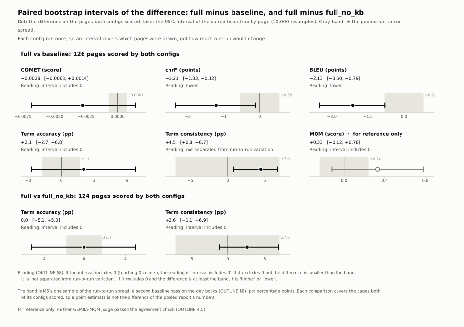
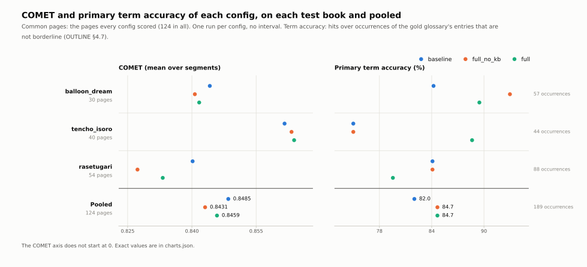
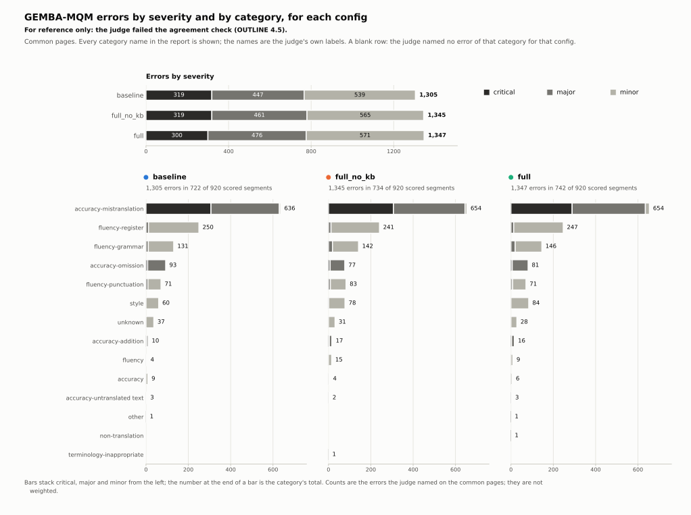
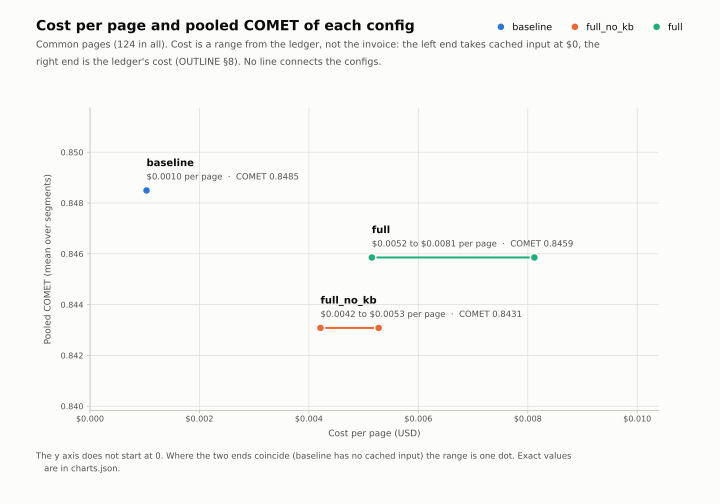
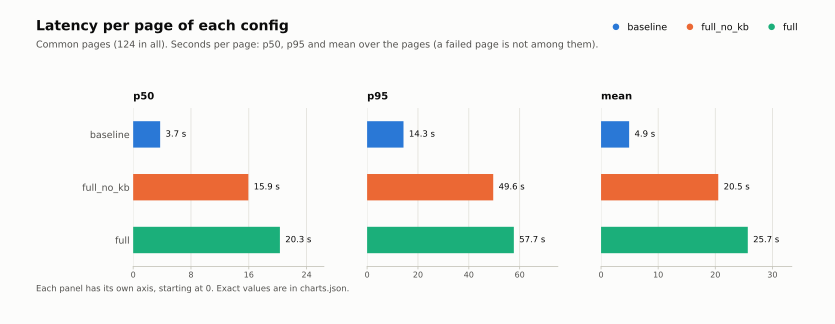

# M8 Record

> 2026-11-06. Goal (OUTLINE §7, planned for 12/28–1/3, 2.5 h): analyse the test runs. That means the paired bootstrap's 95% intervals for both comparisons, GEMBA-MQM's error breakdown by category and severity, a cost / latency summary, and charts. M8 started right after M6 instead of on 12/28, because the test runs were scored and the bootstrap's code had been merged before them (OUTLINE §8, "When the intervals are computed"). **Every number here comes from the test runs of M6 (`docs/m6.md`).** No model was called in M8.

## How to run

All three tools read files only. They take the nine test eval runs, the same inputs as the pooled report:

```bash
uv run python eval/bootstrap.py <the nine eval runs> --mqm-judge gpt-4o-mini-2024-07-18
uv run python eval/costs.py <the nine eval runs> \
  --ledger-range 20261030T215155Z-baseline=1469-1504 --ledger-range 20261031T031334Z-baseline=1728-1767 \
  --ledger-range 20261031T034431Z-baseline=2000-2053 --ledger-range 20261030T215623Z-full_no_kb=1505-1606 \
  --ledger-range 20261031T031700Z-full_no_kb=1768-1874 --ledger-range 20261031T035104Z-full_no_kb=2054-2220 \
  --ledger-range 20261030T230706Z-full=1607-1726 --ledger-range 20261031T032932Z-full=1875-1999 \
  --ledger-range 20261031T041156Z-full=2221-2457
uv run eval/charts.py --report runs/report/20261031T053821Z-report/report.json \
  --bootstrap runs/bootstrap/20261101T023151Z-bootstrap/bootstrap.json \
  --costs runs/analysis/20261101T035019Z-costs/costs.json
```

- **The ledger ranges.** `runs/usage.jsonl` has one line per call and no run id, so the cost summary is told which lines each eval run wrote. It refuses a range that does not split into the run's pages.
- **The charts script.** `eval/charts.py` is a PEP 723 script like `eval/comet.py`: `uv run` builds its own environment with `matplotlib`, and the project's environment never gets it.
- **The official outputs are computed.** Run these commands again only with a scratch `--out-root`.

## What was built

M8 was three tasks and three docs PRs, this record included:

| Task | What it added | PR |
|---|---|---|
| The intervals | Two tests that pin details of the consistency label. Then the intervals on the test runs, computed once | #61 |
| Docs | The intervals in OUTLINE §7, and how they are read next to the run-to-run spread (§8) | #62 |
| The cost / latency summary | `evaluation/costs.py`, its CLI `eval/costs.py` and 99 tests. Cost per page is a range, because the ledger does not show what cached input was billed at | #63 |
| Docs | The summary's numbers, and two corrected claims: cost was "about 8 times" `baseline`'s, and the MQM error breakdown was said to be missing | #64 |
| The charts | `eval/charts.py`, five charts and `charts.json`, with 71 tests that run without `matplotlib` | #65 |
| Docs | This record, the charts in `docs/figures/`, and M8 closed in OUTLINE §7 | this PR |

The MQM error breakdown needed no tool of its own: the pooled report has held it since #52.

## Structure

| Part | Location |
|---|---|
| Intervals | `runs/bootstrap/20261101T023151Z-bootstrap/bootstrap.json` (gitignored), code in `backend/fukidashi/evaluation/bootstrap.py` |
| Cost / latency summary | `runs/analysis/20261101T035019Z-costs/costs.json` (gitignored), code in `backend/fukidashi/evaluation/costs.py`, CLI `eval/costs.py` |
| MQM error breakdown | `pooled[config].mqm.breakdown` and `by_book[book][config].mqm.breakdown` in `runs/report/20261031T053821Z-report/report.json` (gitignored) |
| Charts | `runs/analysis/20261104T204927Z-charts/` (SVG, PNG and `charts.json`; gitignored), the SVGs in [`docs/figures/`](figures/), script `eval/charts.py` |

## Design decisions

The reasons are in [OUTLINE.md §8](../OUTLINE.md#8-decisions). The short form:

- **The intervals were computed once, right after M6.** Their details were fixed before the first test page (#58, #59), so nothing waited on the calendar.
- **They are read next to the run-to-run spread, and that reading can only weaken a claim.** Each config ran once, so an interval covers which pages were drawn, not how much a rerun would change. A difference counts only when its interval excludes 0. When its interval excludes 0 but the difference is smaller than M5's pooled spread, it is "not separated from run-to-run variation". The rule was written after the intervals were computed, which is why it may only weaken a claim.
- **Cost per page is a range.** The low end takes cached input at $0, and the high end is the ledger's cost, which prices every input token at the input rate. The prices come from the ledger lines themselves. These figures are arithmetic on the ledger, not the invoice.
- **The charts apply the reading themselves.** No output file holds it. The script takes M5's six spreads as constants, and a test checks them against the OUTLINE §8 row. Every number on a chart is in `charts.json` with its source file and key path, and a null is listed, never drawn as 0.

## The intervals

`full` minus the other config. Paired bootstrap by page, 10,000 resamples, 95% intervals. The spread is M5's one sample, a second `baseline` pass on the dev books.

| Comparison (pages) | Metric | Difference | Interval | Spread | Reading |
|---|---|---|---|---|---|
| `full` vs `baseline` (126) | COMET (primary) | −0.0028 | [−0.0068, +0.0014] | 0.0007 | interval includes 0 |
| | chrF | −1.21 | [−2.33, −0.12] | 0.55 | lower |
| | BLEU | −2.13 | [−3.50, −0.79] | 0.81 | lower |
| | Primary term accuracy | +2.1 pp | [−2.7, +6.8] | 1.7 pp | interval includes 0 |
| | Term consistency | +4.5 pp | [+0.8, +6.7] | 7.0 pp | not separated from run-to-run variation |
| | GEMBA-MQM (for reference only) | +0.33 | [−0.12, +0.78] | 0.24 | interval includes 0 |
| `full` vs `full_no_kb` (124) | Primary term accuracy (primary) | +0.0 pp | [−5.1, +5.0] | 1.7 pp | interval includes 0 |
| | Term consistency | +2.6 pp | [−1.1, +6.9] | 7.0 pp | interval includes 0 |



**What this says:**
- **Neither primary metric shows a gain.** The full system does not beat one call per page on COMET, and the Knowledge Base does not raise term accuracy.
- **`full` is lower than `baseline` on chrF and BLEU.** Both intervals exclude 0, and both differences are larger than the spread.
- **The consistency gain over `baseline` is not separated from run-to-run variation.** Its interval excludes 0, but +4.5 pp is smaller than the 7.0 pp that a second `baseline` pass moved on the dev books.
- **Pages.** Each comparison covers the pages both of its configs scored, so its point estimate is not the difference of the report's pooled numbers. COMET is −0.0028 here, on 126 pages, and −0.0026 in the report, on the 124 common pages.

Both consistency intervals are labelled results: every run's extractor was right on at least 92.9% of its checks. MQM's interval is for reference only, because neither judge passed the agreement check (M5).

## Term accuracy, entry by entry

M6's record left a question for this milestone: which glossary entries make the books differ? Pooled, `full` is 2.6 pp above `baseline` and level with `full_no_kb`. Per book, it is 13.6 pp above `baseline` on `tencho_isoro` and 4.6 pp below on `rasetugari`.



On the common pages, each book's difference between `full` and `baseline` comes from one or two entries:

| Book | Entry | Occurrences | Hits: `baseline` / `full_no_kb` / `full` | `full`'s rendering | In `full`'s KB |
|---|---|---|---|---|---|
| `tencho_isoro` | `mel` (a character) | 8 | 2 / 3 / 8 | 梅尔, the reference's | Yes: a profile from page 4, waiting for a person (`pending_human`) |
| `balloon_dream` | `asagao` | 6 | 1 / 4 / 6 | 朝颜, the reference's | Yes: approved, from page 2 |
| `balloon_dream` | `astronomy-club` | 4 | 2 / 3 / 0 | 天文社 (reference: 天文部) | Yes: approved, from page 5 |
| `rasetugari` | `obsession` | 11 | 5 / 3 / 0 | 妄执 (reference: 执念) | No: proposed on page 46, rejected by the Curator as an ordinary word |

- **How the books' totals break down.** `mel` accounts for all of `tencho_isoro`'s +6 hits. On `rasetugari`, `obsession` gives −5 and `miasma` +1, so the net is −4. On `balloon_dream`, `asagao` gives +5 and `astronomy-club` −2, so the net is +3.
- **What the renderings show.** In `full`, each of the four entries has one rendering throughout. Where the KB held the reference's rendering, `full` hit every occurrence. Where it held another (天文社), `full` hit none. This matches what the dev books showed (OUTLINE §9): the KB keeps a rendering consistent, but it does not correct it.
- **`obsession` is not the KB's doing.** The entry was rejected, yet `full` still used 妄执 every time. `baseline` and `full_no_kb` used it too, on 5 and 8 of the 11 occurrences.
- **Where the data comes from.** The renderings are as the judge extracted them for term consistency, and the hits are from `terms.json`. Each config ran once and the counts are small, so these are observations, not tested differences.

## The MQM error breakdown (for reference only)

On the common pages: 920 scored segments, each scored once by GPT-4o mini.

| | `baseline` | `full_no_kb` | `full` |
|---|---|---|---|
| Errors | 1,305 | 1,345 | 1,347 |
| Segments with at least one error | 722 | 734 | 742 |
| Critical / major / minor | 319 / 447 / 539 | 319 / 461 / 565 | 300 / 476 / 571 |
| `accuracy-mistranslation` | 636 | 654 | 654 |
| `fluency-register` | 250 | 241 | 247 |
| `fluency-grammar` | 131 | 142 | 146 |



**What the breakdown shows:**
- **`accuracy-mistranslation` dominates.** In every config it is about half of the errors (48.6% to 48.7%) and 96% of the critical ones. The next two categories are almost all minor.
- **The configs look alike.** The category names are the judge's own labels; it used 14 of them, including `unknown`.
- **This is not evidence.** Neither judge passed the agreement check, and MQM's interval includes 0, so the breakdown describes what the judge marked. It does not show a difference between the configs.

## Cost and latency

On the 124 common pages:

| | `baseline` | `full_no_kb` | `full` |
|---|---|---|---|
| Calls per page | 1.00 | 2.89 | 3.78 |
| Cached share of input | 0% | 57.2% | 77.3% |
| Cost per page | $0.001033 | $0.004212 to $0.005274 | $0.005150 to $0.008120 |
| Latency p50 / p95 / mean | 3.7 / 14.3 / 4.9 s | 15.9 / 49.6 / 20.5 s | 20.3 / 57.7 / 25.7 s |

- **Cost.** `full` costs 5.0 to 7.9 times `baseline` per page, and 1.2 to 1.5 times `full_no_kb`. `baseline` has no cached input, so its range is one number.
- **Latency.** `full`'s p50 is about 5.4 times `baseline`'s.
- **Failed pages.** Their calls count on the attempted pages, which `costs.json` also reports. Where a failed page's call has no usage, a cell there is `n/a`, never a partial sum.





## Provenance

- **Rebase merges changed the commits.** The official files record the commit of the task branch they ran on, and each of those commits reached `main` under another SHA:
  - the intervals: `7bba960`, on `main` as `b5725d3`;
  - the cost summary: `6ded179`, on `main` as `2dcb673`;
  - the charts: `454266f`, on `main` as `8402b76`.
- **The charts record their script's sha256** (`daead322…`), which survives a rebase, as well as `matplotlib` 3.11.2 and the sha256 of their three inputs.
- **Absolute paths into removed worktrees.** The input files hold absolute paths into the task worktrees they were made in:
  - the report: `runs[].directory`, in `Fukidashi-task-030`;
  - the intervals: `inputs.glossary_dir`, in `Fukidashi-task-031`;
  - the cost summary: `inputs.ledger.path` and `inputs.glossary_dir`, in `Fukidashi-task-032`.

  Those worktrees were removed on 2026-11-02. Their `runs` were links to the main checkout's, so every eval run and the ledger are still where they were. The glossary files on `main` have the hashes that the protocol pins and the report records.

## Spend and time

**No model was called in M8.** The ledgers have 2,457 translation lines and 10,693 judge lines, as at the end of M6, and stand at $8.83 of the $100 cap.

**Time.** M8 was planned at 2.5 hours, for 12/28–1/3. Its three tasks and two earlier docs PRs were merged between 2026-11-01 02:54 UTC (#61) and 2026-11-05 01:22 UTC (#65). The active hours were not measured.

## Lessons

- **Read the outputs before calling something missing.** The docs said the MQM error breakdown was still to come, but the report had held it since #52 (corrected in #64).
- **In zsh, an unquoted variable stays one argument.** Twice in M8, a check of hashes "before and after" compared two empty outputs and printed "identical": once in the charts task, and once after the worktrees were removed. Both were noticed and done again properly. Pass file lists as arrays or as explicit arguments, and check that the outputs are not empty.
- **Record a file's hash beside a commit.** A rebase merge gives a commit a new SHA, but a file keeps its bytes.
- **Check a mechanism in the data before writing it down.** On `rasetugari`, the KB was the obvious cause of `full`'s misses. The KB tables showed it was not.

## Not done / not verified

- **Bytes on another machine.** The charts give the same bytes for the same inputs on this machine. Their script pins `matplotlib`, but its other dependencies float (`IDEAS.md`).
- **The review's minor findings on the charts** are in `IDEAS.md`. None of them affects an official chart.
- **The provider's invoices** were not checked. Cost is the ledger's arithmetic.
- **The entry-by-entry account** covers the four entries behind the per-book differences. It rests on one run per config, with no interval.
- **The report (M9) and the blog posts** come later. M7, the editor, has not started.
