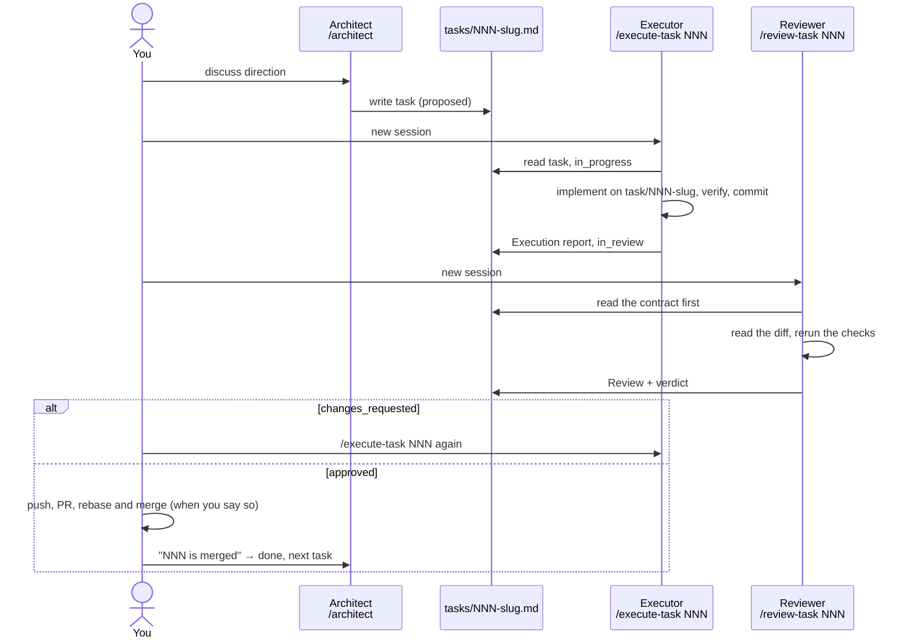

# Workflow: Architect → Executor → Reviewer

> 2026-10-24. This is the guide for people. The rules themselves (who may change what, how status moves, how git is used) are in "Task workflow" in [CLAUDE.md](../CLAUDE.md), and the full instructions for the three roles are in `.claude/commands/`.

Three separate chat sessions hand work over through one task file:

## How to use it

1. Open a new session and type `/architect`, optionally with a question, for example `/architect what should M2 start with`. It reads OUTLINE, SCOPE, IDEAS and git first, tells you where things stand, then answers.
2. Discuss in the architect session. Once the work is settled, it shows you a task draft in chat (goal, scope, acceptance criteria) and writes `tasks/NNN-slug.md` only after you agree.
3. Open a new session and type `/execute-task NNN`. The executor knows only the task file and the repository: it implements, verifies and commits on branch `task/NNN-slug`, then writes the Execution report into the task file. It does not push or open a PR.
4. Open another new session and type `/review-task NNN`. The reviewer reads the acceptance criteria first, then reads the diff and reruns the Verification itself, and only then compares with the Execution report. It does not change the repository; it writes the Review and a verdict.
5. If the verdict is approved, you decide when to push, open the PR and rebase and merge; after merging, tell the architect, which marks the task done and suggests the next one. If the verdict is changes requested, go back to step 3 with the same `/execute-task NNN`; the executor reads the latest Review.

## Why it is built this way

- **The reviewer is a new session.** It has none of the executor's context and reads the contract (acceptance criteria) before the executor's account, so it does not follow the report's line of thought.
- **One task, one PR**, as in OUTLINE §10. Tasks are small (about 1–4 hours), and acceptance criteria must be checkable by a command or an observation.
- **Task files stay local.** `tasks/` is gitignored, and every session finds the same directory in the main checkout through git's common dir, whether it runs in the main checkout or in a worktree, and switching branches never loses it. The cost is that tasks are not in git history; anything that should be kept goes into the PR description and `docs/mN.md`.

## Limits

- Role boundaries are conventions written into prompts, not permission isolation: the architect not editing code and the reviewer not changing the repository rely on instructions, not on enforcement.
- When several sessions share one checkout, only one executor runs at a time. The executor checks for changes it did not make before starting.
- The reviewer and the executor are the same model. What is independent is the context, not the capability, so the reviewer's verdict still deserves a look at the diff from you.
