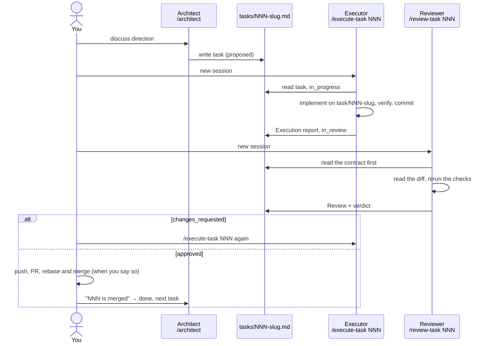

# Workflow: Architect → Executor → Reviewer

> 2026-10-24。这份是给你看的使用说明。规则本身（谁能改什么、状态怎么流转、git 怎么用）在 [CLAUDE.md](../CLAUDE.md) 的 “Task workflow”，三个角色的完整指令在 `.claude/commands/`。

三个互相独立的 chat session，靠一个 task 文件交接：

## 怎么用

1. 开一个新 session，输入 `/architect`。可以直接带上问题，例如 `/architect M2 应该先做哪一块`。它会先读 OUTLINE、SCOPE、IDEAS 和 git，告诉你现在的状态，再回答。
2. 在 architect 里讨论。想做的事定下来后，它先在聊天里给你看 task 草稿（goal、scope、验收标准），你同意了才写成 `tasks/NNN-slug.md`。
3. 新开一个 session，输入 `/execute-task NNN`。executor 只知道 task 文件和仓库：它在 `task/NNN-slug` 分支上实现、验证、commit，把 Execution report 写进 task 文件。它不会 push，也不会开 PR。
4. 再新开一个 session，输入 `/review-task NNN`。reviewer 先读验收标准，再自己读 diff、自己跑 Verification，最后才对照 Execution report。它不改仓库，只写 Review 和结论。
5. 结论是 approved：你决定什么时候 push、开 PR、rebase and merge；合并后回 architect 说一声，它把 task 标成 done 并建议下一个。结论是 changes requested：回到第 3 步，用同一条 `/execute-task NNN`，executor 会读最新的 Review。

## 为什么这样设计

- **Reviewer 是新 session。** 它没有 executor 的上下文，先读合同（验收标准）、后读 executor 的说法，所以不会顺着 report 的思路走。
- **一个 task 一个 PR**，和 OUTLINE 第 10 节一致。task 要小（约 1–4 小时），验收标准要能用命令或观察来检查。
- **task 文件放在本地。** `tasks/` 被 gitignore，所有 session 都通过 git common dir 找到主 checkout 里的同一个目录，不管它们跑在主 checkout 还是 worktree 里，切分支也不会弄丢。代价是 task 不进 git 历史；要留痕的内容放进 PR 描述和 `docs/mN.md`。

## 限制

- 角色边界是写在 prompt 里的约定，不是权限隔离：architect 不改代码、reviewer 不改仓库，靠指令，系统不会强制。
- 几个 session 共用同一个 checkout 时，同一时间只让一个 executor 在跑。executor 开工前会检查工作区有没有不是它改的东西。
- reviewer 和 executor 是同一个模型。独立的是上下文，不是能力，所以 reviewer 的结论仍然值得你自己扫一眼 diff。
